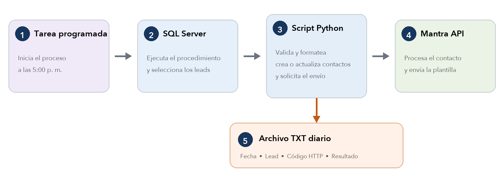

# JS Industrial → Mantra ETL

Integración de cotizaciones de `JSIndustrial` con contactos de Mantra en **SRV-02**. Crea o actualiza contactos; no envía mensajes ni plantillas.

## Flujo diario

```text
05:00, tarea de Windows en SRV-02
    → dbo.JS_usp_ExportarCotizacionesMantra
    → C:\Mantra\outbox\cotizaciones_*.local.json
    → API Mantra /contacts/new
    → dbo.JS_usp_ConfirmarExportacionMantra
    → dbo.JS_MantraExportaciones
```

La tarea ejecuta [`run_mantra_local.ps1`](mantra_integracion/run_mantra_local.ps1). El login SQL `mantra`, su contraseña, `MANTRA_GROUP_ID` y `MANTRA_API_KEY` se leen de un `.env` local excluido de Git. Se usa `config.local.json` para seleccionar los campos enviados. El SP conserva las 23 propiedades del Excel en el JSON; Mantra recibe los ocho campos del [mapeo activo](mantra_integracion/mapeo_campos_mantra.csv). Los envíos exitosos quedan registrados en SQL para que el SP no los seleccione de nuevo.

El [runbook](mantra_integracion/runbook.md) contiene la instalación y la prueba manual antes de registrar la tarea diaria.



La imagen corresponde a la propuesta inicial; el flujo operativo vigente es el descrito arriba.

## Carpetas

- [`diagrama-mantra/`](diagrama-mantra/): esquema, diagrama de entidades, auditoría de campos y SQL del SP.
- [`mantra_integracion/`](mantra_integracion/): exportación JSON, envío al API, programación, configuración de ejemplo y pruebas.

El backup, los JSON con contactos, las claves y los logs no se versionan.
