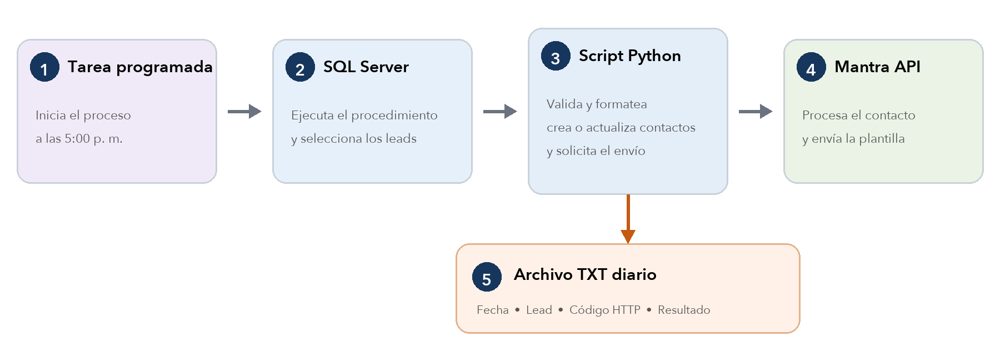

# Integración local JSIndustrial → Mantra

La tarea diaria de Windows ejecuta [`run_mantra_local.ps1`](run_mantra_local.ps1) en `SRV-02` a las 05:00, hora local del servidor. Primero se genera un JSON en `C:\Mantra\outbox`; después se crean o actualizan los contactos en Mantra. Solo las respuestas HTTP 200/201 se confirman en `dbo.JS_MantraExportaciones`. Los errores quedan en `C:\Mantra\logs` y vuelven a ser elegibles en la siguiente ejecución.

```text
CotizacionesC → SP de exportación → JSON → API Mantra → SP de confirmación
```

El [runbook](runbook.md) explica cómo preparar `.env`, `config.local.json`, Python y la tarea. El `.env` contiene `MANTRA_SQL_USER`, `MANTRA_SQL_PASSWORD`, `MANTRA_GROUP_ID` y `MANTRA_API_KEY`; está excluido de Git y debe limitarse a Administradores y `SYSTEM`.

## Campos enviados

El JSON conserva 23 propiedades de origen. `config.local.json` envía los siguientes ocho campos:

| Destino Mantra | Propiedad JSON | Origen SQL |
| --- | --- | --- |
| `custom_1` | `numero_cotizacion` | serie, número y revisión de `dbo.CotizacionesC` |
| `custom_2` | `fecha` | `fecemidoc` |
| `custom_3` | `cliente` | `txtrazsoc` |
| `custom_5` | `vendedor` | `codmtrven` |
| `custom_7` | `referencia` | `txtrefcot`; `-` si está vacío |
| `custom_13` | `genero_orden_venta` | `numpedgen`; las cotizaciones con orden se excluyen |
| `data.name` | `nombre_contacto` | `txtnomatt`, o cliente si falta |
| `data.phone` | `telefono` | `txttlf001`, normalizado a nueve dígitos |

El SP selecciona cotizaciones con más de dos días completos, sin orden de venta y con teléfono válido. Deduplica por teléfono y omite los que constan como enviados en `dbo.JS_MantraExportaciones`. El [CSV de mapeo](mapeo_campos_mantra.csv) detalla estas posiciones.


