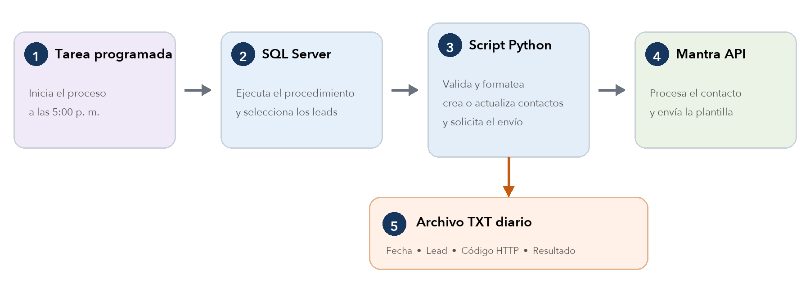

# Integración piloto SQL Server → Mantra



La imagen refleja la propuesta original. **El alcance actual termina en crear o actualizar contactos; no se envían plantillas ni mensajes.**

Para instalarlo en Windows con SQL Server Agent, sigue el [runbook paso a paso](runbook.md).

## Flujo implementado

1. SQL Server Agent ejecuta un job diario con un paso `CmdExec` que llama `run_mantra.ps1` y, desde allí, a Python. El [script de registro del job](registrar_job_sql_agent.sql) queda preparado para instalarlo en el servidor Windows. El antiguo `registrar_tarea.ps1` queda como alternativa; no se deben activar ambos programadores.
2. Python llama `dbo.JS_usp_ExportarCotizacionesMantra` con la fecha actual de Lima. El SP considera todas las cotizaciones anteriores a esa fecha menos dos días completos, excluye las que ya generaron orden de venta (`numpedgen = 1`) y los teléfonos con envío exitoso en `dbo.JS_MantraExportaciones`. Si hay varias cotizaciones pendientes para un teléfono, toma la más reciente. Devuelve `payload_json` con 23 propiedades de origen e `ids_json` con los identificadores internos; Python envía a Mantra solo los ocho campos configurados.
3. El SP quita `+51` y otros separadores del teléfono y devuelve nueve dígitos peruanos en `telefono`. Python vuelve a validarlo y envía `countryCode="51"` separado del número. También acepta archivos JSON antiguos con prefijo 51 y los normaliza antes del API.
4. Envía `POST https://wbpback.mantra.chat/contacts/new` con `groupId`, `apiKey`, `data.name`, `data.phone`, `data.countryCode` y los seis `custom_*` de la tabla siguiente. El correo queda desactivado en la configuración de ejemplo.
5. Después de una respuesta HTTP 200/201, Python llama `dbo.JS_usp_ConfirmarExportacionMantra` para registrar el teléfono como enviado. Escribe un TXT diario `mantra_AAAAMMDD.txt` con hora, identificador de cotización, etapa, HTTP y resultado; no incluye credenciales ni teléfono/correo. Un fallo del API o de validación no marca el teléfono y permite reintentar en la siguiente ejecución.

`genero_orden_venta` proviene del booleano `numpedgen`: `true` (`1`) significa que la cotización se completó y generó orden de venta, por lo que **no se envía a Mantra**. Solo se consideran cotizaciones con `false` (`0`); en `custom_13` ese valor aparece como `-`, siguiendo el formato del Excel. La marca de exportación se guarda por teléfono peruano normalizado, no por número de cotización. Una vez enviado el contacto, nuevas cotizaciones del mismo teléfono no se vuelven a exportar automáticamente.

La importación activa usa los ocho campos visibles en la captura: seis `custom_*` y dos datos estándar (`data.name` y `data.phone`). Conservamos los números `custom_*` anteriores para no cambiar el significado de los campos que ya se probaron en Mantra. El SP sigue devolviendo 23 propiedades para la exportación JSON, pero Python solo envía los campos activos de `config.json`. `countryCode=51` se añade por separado. La [tabla CSV de mapeo](mapeo_campos_mantra.csv) muestra los ocho campos activos y sus orígenes SQL.

| Posición Mantra | Propiedad JSON | Columna del Excel |
| --- | --- | --- |
| `custom_1` | `numero_cotizacion` | N° Cotización |
| `custom_2` | `fecha` | Fecha |
| `custom_3` | `cliente` | Cliente |
| `custom_5` | `vendedor` | Vendedor |
| `custom_7` | `referencia` | Referencia |
| `custom_13` | `genero_orden_venta` | Generó O/V |
| `data.name` | `nombre_contacto` | Nombre del contacto |
| `data.phone` | `telefono` | Teléfono |

El vendedor se envía como código (`codmtrven`) porque falta su catálogo de nombres. El nombre del contacto usa el cliente si `txtnomatt` está vacío; las filas sin teléfono válido no entran al JSON. Los otros campos de origen permanecen en el JSON del SP, pero no se incluyen en la llamada al API. Si hay varias cotizaciones elegibles para el mismo teléfono, el SP entrega solo la más reciente.

## Probar con el JSON ficticio

Primero copia `.env.example` a `.env` si todavía no existe. Git ignora el `.env` local. Para una simulación no necesitas completar credenciales. Desde `mantra_integracion/`, ejecuta:

```bash
python exportar_contactos.py --config config.example.json --json-file contactos_prueba.json --log-dir ./logs
```

En Windows el comando es el mismo, usando `py` si así está instalado Python. Este modo no requiere SQL Server, `groupId` ni API key; valida los tres objetos de ejemplo y escribe el resultado en `./logs`. No llama a Mantra. El archivo ficticio no se puede enviar con `--apply` porque no tiene los identificadores internos para confirmar el envío en SQL.

Para inspeccionar pendientes en SQL Server, ejecuta `EXEC dbo.JS_usp_ExportarCotizacionesMantra @FechaProceso='2026-02-05';`. Ese día se consideran cotizaciones anteriores al 3 de febrero. El resultado incluye `payload_json` e `ids_json`. Para guardarlos juntos en un archivo de prueba, usa `--export-json` como se indica abajo. La ejecución diaria sigue leyendo el SP directamente; el archivo manual también puede enviarse con `--apply` porque conserva ambos arreglos y confirma cada éxito en SQL.

## Prueba manual: SP → archivo JSON → Mantra

En la máquina Windows, primero ejecuta el SP en SSMS para revisar los pendientes: `EXEC dbo.JS_usp_ExportarCotizacionesMantra @ComoJson=0;`. La columna `id_interno` permite elegir una cotización para una prueba limitada. El SP **devuelve** JSON; Python lo guarda como archivo para evitar copiar o truncar una celda larga de SSMS.

Desde `mantra_integracion/`, con `config.json` y `.env` preparados:

```powershell
& "C:\Mantra\venv\Scripts\python.exe" .\exportar_contactos.py --config .\config.json --export-json .\pendientes.local.json --codidtcot COD_INTERNO
& "C:\Mantra\venv\Scripts\python.exe" .\exportar_contactos.py --config .\config.json --json-file .\pendientes.local.json
& "C:\Mantra\venv\Scripts\python.exe" .\exportar_contactos.py --config .\config.json --json-file .\pendientes.local.json --apply
```

Quita `--codidtcot COD_INTERNO` para exportar todos los pendientes. El archivo debe terminar en `.local.json`; Git lo ignora en esta carpeta porque contiene datos de contactos. La segunda línea valida sin llamar al API. La tercera crea o actualiza contactos reales en Mantra, comprueba otra vez que cada cotización siga pendiente y registra en `dbo.JS_MantraExportaciones` cada HTTP 200/201. Si un contacto ya se envió, su oferta generó orden o sus datos cambiaron desde la exportación, se omite y se debe regenerar el archivo cuando corresponda.

Las ocho columnas visibles en la captura tienen salida: `N° Cotización`→`custom_1`, `Fecha`→`custom_2`, `Cliente`→`custom_3`, `Vendedor`→`custom_5`, `Referencia`→`custom_7`, `Nombre del contacto`→`data.name`, `Teléfono`→`data.phone` y `Generó O/V`→`custom_13`. El backup solo trae el **código** del vendedor (`codmtrven`), no el nombre mostrado en el Excel; para enviar ese nombre hace falta el catálogo de vendedores. Las filas con teléfono ausente o inválido no entran al JSON. Las cotizaciones con `Generó O/V = true` tampoco entran porque ya se completaron.

## Variables de `.env`

Edita `mantra_integracion/.env` con un editor de texto. Python lo lee automáticamente al ejecutar cualquiera de los dos scripts; las variables existentes en el sistema tienen prioridad. Git ignora el archivo para que las credenciales no se publiquen.

| Variable | Cuándo se necesita | Valor |
| --- | --- | --- |
| `MANTRA_GROUP_ID` | Consulta o creación de contactos | ID del grupo en Mantra |
| `MANTRA_API_KEY` | Consulta o creación de contactos | API key de ese grupo |

En el flujo con SQL Server Agent, `config.json` usa `sql.authentication = "windows"`. Python se conecta con la identidad de Windows del proxy del job mediante ODBC; **no necesita usuario ni contraseña de SQL en `.env`**. El servidor y la base se configuran en `config.json`. La cuenta proxy necesita permisos `EXECUTE` sobre ambos SP, lectura del `.env` y escritura en la carpeta de logs. La API key de Mantra sí sigue en `.env`.

Para pruebas fuera de ese servidor, se conserva el modo opcional `sql.authentication = "sql"`, que usa `MANTRA_SQL_USER` y `MANTRA_SQL_PASSWORD` como variables de entorno. No se requieren en el job con autenticación de Windows.

## Preparación en Windows

1. En el servidor Windows que ejecuta SQL Server Agent, instalar Python 3.10+, las dependencias de `requirements.txt` y Microsoft ODBC Driver 18 for SQL Server. La conexión integrada exige que la cuenta del job tenga acceso al servidor SQL y que su certificado TLS sea confiable para ODBC.
2. Ejecutar todo el SQL de `../diagrama-mantra/usp_ExportarCotizacionesMantra.sql` en `JSIndustrial`. Crea `dbo.JS_MantraExportaciones`, una función de normalización de teléfono y dos SP. El archivo establece `USE [JSIndustrial]`.
3. Copiar `config.example.json` a `config.json` y definir servidor y carpeta de logs. La base ya figura como `JSIndustrial`; mantener `"authentication": "windows"`. `config.json` todavía no está creado en esta copia del proyecto.
4. Completar solo `MANTRA_GROUP_ID` y `MANTRA_API_KEY` en `.env`. Dar acceso de lectura a ese archivo únicamente a la cuenta que ejecutará el job. No guardar secretos en `config.json`, el repositorio o el TXT.
5. Probar sin modificar Mantra: `powershell -File .\run_mantra.ps1 -PythonExe "C:\Mantra\venv\Scripts\python.exe" -Limit 1 -DryRun`. Revisar el TXT y el conteo de contactos pendientes. En SSMS, `EXEC dbo.JS_usp_ExportarCotizacionesMantra @ComoJson=0, @MaxContactos=1;` muestra el primero. El límite se aplica después de los filtros y la deduplicación por teléfono.
6. Tras confirmar el mapeo y la regla, ejecutar una prueba de un contacto con `powershell -File .\run_mantra.ps1 -PythonExe "C:\Mantra\venv\Scripts\python.exe" -Limit 1`. Revisar el TXT y `dbo.JS_MantraExportaciones` para comprobar qué teléfono se confirmó. Quitar `-Limit 1` para procesar todos los pendientes; el job diario no lleva límite.
7. El administrador de SQL Server debe crear un proxy de Agent habilitado para `CmdExec` con una cuenta de Windows de permisos limitados. Editar `@ProxyName`, `@Launcher`, `@PythonExe` y `@HoraHHMMSS` en `registrar_job_sql_agent.sql` y ejecutar el script en SSMS. La hora se interpreta en la zona horaria del **servidor**, mientras Python calcula la fecha de selección en Lima. El job recupera pendientes de días anteriores. No crear además la tarea con `registrar_tarea.ps1`.

El job de SQL Server Agent es un objeto de `msdb` administrado por el servicio SQL Server Agent; el SP de la base sigue generando el JSON. Agent dispara Python, y Python llama al SP usando la identidad de Windows del proxy. SQL Server Express no permite utilizar SQL Server Agent para esta programación; en esa edición se puede usar el Programador de tareas de Windows con la misma autenticación integrada.

## Prueba de acceso a Mantra sin SQL Server

Completa `MANTRA_GROUP_ID` y `MANTRA_API_KEY` en `.env`. Usa un número de prueba autorizado; el script nunca imprime los secretos ni el contenido del contacto consultado.

En Windows puedes usar `powershell -File .\probar_mantra.ps1 -Phone 987654321`. El script Python lee `.env` automáticamente. Sin `-Name` hace solo la consulta de credenciales; con `-Name "Prueba JS Industrial"` crea o actualiza el contacto de prueba.

1. Solo lectura, valida las credenciales sin modificar contactos: `python probar_mantra.py --phone 987654321`. Un HTTP 200 o 404 indica que Mantra aceptó las credenciales para `/contacts/byphone`.
2. Crear o actualizar el contacto de prueba: `python probar_mantra.py --phone 987654321 --name "Prueba JS Industrial"`.

El paso 2 escribe en Mantra, pero no envía ningún WhatsApp.

## Definiciones pendientes antes de producción

- Las cotizaciones sin `fecemidoc` no son seleccionables.
- Las ejecuciones simultáneas y una caída después de que Mantra acepte el contacto pero antes de confirmar en SQL pueden causar un reintento. Mantra actualiza el contacto por teléfono, pero la confirmación estricta entre API y SQL no es atómica.
- Confirmar las etiquetas visibles de los seis `custom_*` activos en Mantra.
- Validar con una fila real el número de cotización calculado.
- Confirmar que `txttlf001` contiene teléfonos correctos de clientes. No se exportan registros con teléfono inválido.
- Definir la equivalencia del código de vendedor si Mantra necesita mostrar su nombre.
- Mantener y respaldar la carpeta de TXT para revisar resultados y errores de cada ejecución.

Antes de reducir el mapeo a ocho campos, se creó un contacto de prueba autorizado en Mantra (HTTP 201, `created`) y una consulta posterior confirmó los datos enviados. El JSON de esa prueba se guardó en `contacto_envio.local.json`, ignorado por Git. La regla de selección y confirmación se probó contra una restauración temporal del backup con cinco cotizaciones ficticias. El job de Agent y la conexión integrada aún no se han probado en el servidor del cliente.
