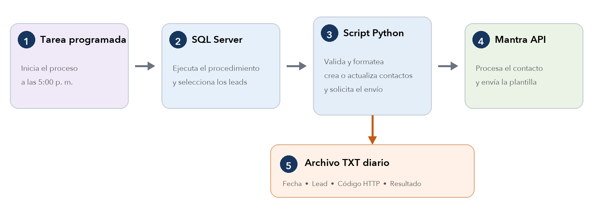

# Integración piloto SQL Server → Mantra



La imagen refleja la propuesta original. **El alcance actual termina en crear o actualizar contactos; no se envían plantillas ni mensajes.**

## Flujo implementado

1. El Programador de tareas de Windows ejecuta `run_mantra.ps1` una vez al día.
2. Python llama `dbo.usp_ExportarCotizacionesMantra` para la fecha anterior (zona horaria de Lima). El SP devuelve una fila `payload_json` con un arreglo de cotizaciones; Python lee y valida los veinte campos personalizados y los tres datos de contacto de cada elemento.
3. Valida nombre y teléfono. Para Perú acepta nueve dígitos que empiecen en 9, con o sin prefijo 51, y envía `countryCode="51"` separado del teléfono.
4. Envía `POST https://wbpback.mantra.chat/contacts/new` con `groupId`, `apiKey`, `data.name`, `data.phone`, `data.countryCode`, correo opcional y hasta veinte `custom_*`.
5. Escribe un TXT diario `mantra_AAAAMMDD.txt` con registros JSON por línea: hora, identificador de cotización, etapa, HTTP y resultado. No incluye credenciales ni teléfono/correo. Si se vuelve a procesar un contacto, Mantra lo actualiza por número telefónico.

El PDF entregado documenta `custom_1` a `custom_10`. La interfaz muestra 20 campos, y una prueba real confirmó que el API guarda `custom_11` y `custom_20`. El JSON incluye los veinte campos personalizados de la tabla siguiente, más `nombre_contacto`, `telefono` y `email`. Estos últimos se envían como `data.name`, `data.phone` y `data.email`; por tanto, **ninguna de las 23 columnas del Excel queda fuera del envío por falta de espacio**. `countryCode` se añade desde la configuración.

| Posición Mantra | Propiedad JSON | Columna del Excel |
| --- | --- | --- |
| `custom_1` | `numero_cotizacion` | N° Cotización |
| `custom_2` | `fecha` | Fecha |
| `custom_3` | `cliente` | Cliente |
| `custom_4` | `condicion_venta` | Condicion de venta |
| `custom_5` | `vendedor` | Vendedor |
| `custom_6` | `fuente_contacto` | Fuente de contacto |
| `custom_7` | `referencia` | Referencia |
| `custom_8` | `moneda` | Moneda |
| `custom_9` | `total_documento` | Total Docum. |
| `custom_10` | `estado_oferta` | Status_Oferta |
| `custom_11` | `total_moneda_nacional` | Total M.N. |
| `custom_12` | `tasa_exito_cierre` | tasa_exito_cierre |
| `custom_13` | `genero_orden_venta` | Generó O/V |
| `custom_14` | `comentario` | Comentario |
| `custom_15` | `usuario` | Usuario |
| `custom_16` | `cargo` | Cargo |
| `custom_17` | `area` | Area |
| `custom_18` | `inventario_disponible` | Invent. Disponible |
| `custom_19` | `porcentaje_inventario_disponible` | % Invent. Dispon. |
| `custom_20` | `fecha_estimada_cierre` | fec_Estim_Cierre |

**Sin valor verificable en el backup:** Cargo, Area, Invent. Disponible, % Invent. Dispon. y fec_Estim_Cierre. El SP los incluye como `null` en el JSON y Python no envía esos `custom_*` hasta que se defina su origen. Los valores de vendedor, condición de venta, fuente y estado siguen siendo códigos/IDs hasta contar con sus catálogos. Cada objeto representa una cotización candidata a contacto; si dos cotizaciones tienen el mismo teléfono, ambas se procesan y Mantra puede actualizar el mismo contacto.

## Probar con el JSON ficticio

Primero copia `.env.example` a `.env` si todavía no existe. Git ignora el `.env` local. Para una simulación no necesitas completar credenciales. Desde `mantra_integracion/`, ejecuta:

```bash
python exportar_contactos.py --config config.example.json --json-file contactos_prueba.json --log-dir ./logs
```

En Windows el comando es el mismo, usando `py` si así está instalado Python. Este modo no requiere SQL Server, `groupId` ni API key; valida los tres objetos de ejemplo y escribe el resultado en `./logs`. No llama a Mantra. El script rechaza `--apply` cuando se usa directamente el archivo `contactos_prueba.json` incluido en el repositorio.

Para un JSON generado desde SQL Server, el SP se puede ejecutar con `EXEC dbo.usp_ExportarCotizacionesMantra @FechaDesde='2026-02-02', @FechaHasta='2026-02-02';`. Copia el contenido de `payload_json` a un archivo UTF-8 si quieres probarlo con `--json-file`. En la ejecución diaria, Python obtiene ese mismo JSON directamente del SP, sin archivo intermedio. Un archivo con datos reales se puede enviar con `--apply` cuando estén configuradas las credenciales y se haya revisado el contenido.

## Variables de `.env`

Edita `mantra_integracion/.env` con un editor de texto. Python lo lee automáticamente al ejecutar cualquiera de los dos scripts; las variables existentes en el sistema tienen prioridad. Git ignora el archivo para que las credenciales no se publiquen.

| Variable | Cuándo se necesita | Valor |
| --- | --- | --- |
| `MANTRA_GROUP_ID` | Consulta o creación de contactos | ID del grupo en Mantra |
| `MANTRA_API_KEY` | Consulta o creación de contactos | API key de ese grupo |
| `MANTRA_SQL_USER` | Solo cuando Python lee el SP directamente | Usuario de SQL Server |
| `MANTRA_SQL_PASSWORD` | Solo cuando Python lee el SP directamente | Contraseña de ese usuario |

Con `--json-file` solo completa las dos variables de Mantra. El servidor y la base SQL se configuran aparte en `config.json` cuando uses el SP. Nunca pongas estas credenciales en el JSON de contactos.

## Preparación en Windows

1. Instalar Python 3.10+ y `pip install -r requirements.txt`.
2. Ejecutar el SQL de `../diagrama-mantra/usp_ExportarCotizacionesMantra.sql` en la base real.
3. Copiar `config.example.json` a `config.json` y definir servidor, base y carpeta de logs. El usuario que ejecute la tarea necesita lectura de `dbo.CotizacionesC` y permiso `EXECUTE` sobre el SP.
4. Completar las cuatro variables de `.env` para la cuenta que ejecutará la tarea. No guardar secretos en `config.json`, el repositorio o el TXT.
5. Probar una fecha sin modificar Mantra: `python exportar_contactos.py --config config.json --fecha 2026-02-02`. Revisar el TXT y el conteo.
6. Tras confirmar el mapeo y la regla, ejecutar una prueba autorizada con `python exportar_contactos.py --config config.json --fecha 2026-02-02 --apply`. Revisar la respuesta 200/201 del contacto en el TXT.
7. Registrar el horario acordado: `powershell -File .\registrar_tarea.ps1 -Hora "07:00"`. La tarea ejecuta la fecha anterior por defecto.

## Prueba de acceso a Mantra sin SQL Server

Completa `MANTRA_GROUP_ID` y `MANTRA_API_KEY` en `.env`. Usa un número de prueba autorizado; el script nunca imprime los secretos ni el contenido del contacto consultado.

En Windows puedes usar `powershell -File .\probar_mantra.ps1 -Phone 987654321`. El script Python lee `.env` automáticamente. Sin `-Name` hace solo la consulta de credenciales; con `-Name "Prueba JS Industrial"` crea o actualiza el contacto de prueba.

1. Solo lectura, valida las credenciales sin modificar contactos: `python probar_mantra.py --phone 987654321`. Un HTTP 200 o 404 indica que Mantra aceptó las credenciales para `/contacts/byphone`.
2. Crear o actualizar el contacto de prueba: `python probar_mantra.py --phone 987654321 --name "Prueba JS Industrial"`.

El paso 2 escribe en Mantra, pero no envía ningún WhatsApp.

## Definiciones pendientes antes de producción

- Confirmar la regla de selección diaria. La implementación actual selecciona `fecemidoc` del día anterior; la propuesta deja esta regla por acordar. Puede haber cotizaciones sin `fecemidoc` o modificaciones posteriores que la regla no capture.
- Confirmar el mapeo de los veinte `custom_*` y si Mantra permite cambiar sus etiquetas visibles.
- Validar con una fila real el número de cotización calculado, la moneda y el total del documento.
- Confirmar que `txttlf001` contiene teléfonos correctos de clientes. No se exportan registros con teléfono inválido.
- Definir equivalencias de los códigos de vendedor, condición de venta, fuente y estado si Mantra necesita sus descripciones.
- Mantener y respaldar la carpeta de TXT para revisar resultados y errores de cada ejecución.

Se creó un contacto de prueba autorizado en Mantra (HTTP 201, `created`) y una consulta posterior confirmó los 13 datos enviados. El JSON de esa prueba se guardó en `contacto_envio.local.json`, ignorado por Git. Aún no se ha probado el SP actual contra el servidor del cliente ni se ha instalado una tarea programada allí.
